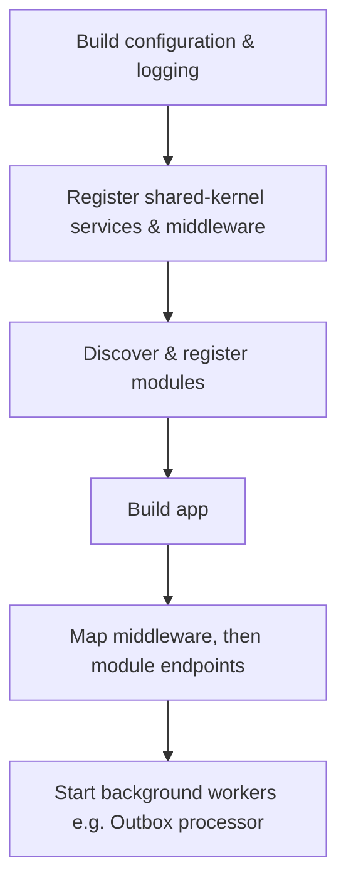

# API Host

[← Docs index](README.md)

`ModularMonolith.Template.Api` is the single

## Responsibilities

- **Module wiring** (`Modular/`) — discovers `[Module]` types, calls `RegisterServices`, `MapEndpoints` and `RegisterHealthChecks`.
- **Security** (`Security/`) — authentication and authorization configuration.
- **Versioning** (`Versioning/`) — API versioning via `Asp.Versioning`.
- **Request pipeline** (`RequestPipeline/`) — correlation-id middleware, rate limiting and request timeouts.
- **Exception handling** (`Exceptions/`) — centralized exception handler producing consistent problem responses.
- **Health checks** (`HealthChecks/`) — aggregates the host and per-module health checks.
- **Observability** (`Observability/`) — Application Insights / telemetry wiring.
- **Logging** (`Logging/`) — structured logging configuration.
- **Messaging** (`Messaging/`) — registers the in-process message dispatcher and handlers.
- **Outbox** (`Outbox/`) — hosts the Outbox processor and dead-letter management endpoints.

## Startup Flow

1. Build configuration and logging.
2. Register shared-kernel services and cross-cutting middleware.
3. Discover and register all modules.
4. Build the app, map middleware, then map each module's endpoints.
5. Start background workers (e.g. the Outbox processor).



## API Versioning

Endpoints are versioned with `Asp.Versioning`. Modules build an `ApiVersionSet` and map routes under a version-templated prefix:

- Route template: `/v{version:apiVersion}/...` (e.g. `/v1/users`).
- Versions are reported in responses via `ReportApiVersions()`.
- A module can support multiple versions by adding more `HasApiVersion(...)` calls to its version set.

This scheme is applied consistently by every module; see [Feature Modules](modules.md).

## Example

Each module exposes its endpoints through `MapEndpoints`, where the host's cross-cutting filters are layered on:

```csharp
public void MapEndpoints(IEndpointRouteBuilder endpoints)
{
    ApiVersion apiVersion = new(1, 0);
    ApiVersionSet apiVersionSet = endpoints.NewApiVersionSet()
                                           .HasApiVersion(apiVersion)
                                           .ReportApiVersions()
                                           .Build();

    RouteGroupBuilder group = endpoints.MapGroup("/v{version:apiVersion}/users")
                                       .WithApiVersionSet(apiVersionSet)
                                       .HasApiVersion(apiVersion);

    group.RequireRateLimiting("default");
    group.WithRequestTimeout("default");

    group.MapPost("/", UserEndpoints.Create)
         .AddEndpointFilter<ValidationFilter<CreateUserRequest>>()
         .AddEndpointFilter<IdempotencyFilter>()
         .RequireAuthorization(AuthorisationPolicies.WriteAccess);
}
```

## Related Docs

- [Architecture](architecture.md)
- [Messaging & Reliability](messaging.md)
- [Shared Kernel](shared-kernel.md)
