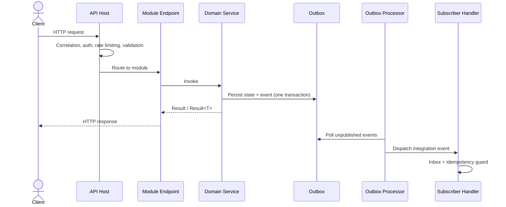

# Architecture

[← Docs index](README.md)

The solution is a **modular monolith**

## Core Ideas

- **Modules are self-contained.** Each module owns its endpoints, domain services, storage, validation and message handlers.
- **Modules never reference each other directly.** The only allowed interactions are through the `*.Contracts` projects (requests/responses/events) and in-process messaging.
- **The host is thin.** `ModularMonolith.Template.Api` discovers modules, applies cross-cutting concerns, and delegates all feature behaviour to modules.
- **Boundaries are enforced by tooling.** Roslyn [analysers](analysers.md) fail the build when a module reaches across a boundary, and [source generators](source-generators.md) remove the wiring boilerplate.

## The Module Contract

Every module implements `IModule` (in the shared kernel) and is marked with `[Module]`:

```csharp
public interface IModule
{
	void RegisterServices(IServiceCollection serviceCollection);
	void MapEndpoints(IEndpointRouteBuilder endpoints);
	void RegisterHealthChecks(IHealthChecksBuilder healthChecks) { }
}
```

- `RegisterServices` — registers options, storage, services, validators and message handlers.
- `MapEndpoints` — maps the module's HTTP endpoints (typically versioned minimal APIs).
- `RegisterHealthChecks` — optional per-module health checks.

## Request & Message Flow

1. A request enters through the API host pipeline (correlation, auth, rate limiting, validation).
2. The relevant module endpoint invokes its domain service.
3. Services return `Result`/`Result<T>` rather than throwing for expected failures.
4. State changes and integration events are persisted transactionally via the **Outbox**.
5. The **Outbox processor** dispatches events; other modules react through registered handlers, guarded by the **Inbox** and **Idempotency** primitives.



## Example

A minimal module implementing the contract:

```csharp
[Module]
public sealed class Module : IModule
{
    public void RegisterServices(IServiceCollection serviceCollection)
    {
        serviceCollection.AddScoped<IUserService, UserService>();
        serviceCollection.AddScoped<IValidator<CreateUserRequest>, CreateUserRequestValidator>();
        serviceCollection.AddMessageHandler<AccountOpenedIntegrationEvent, AccountOpenedHandler>();
        serviceCollection.AddMessageContract<UserUpdatedIntegrationEvent>();
    }

    public void MapEndpoints(IEndpointRouteBuilder endpoints)
    {
        RouteGroupBuilder group = endpoints.MapGroup("/v{version:apiVersion}/users");
        group.MapGet("/{id:int}", UserEndpoints.Get);
        group.MapPost("/", UserEndpoints.Create)
             .AddEndpointFilter<ValidationFilter<CreateUserRequest>>();
    }
}
```

## Related Docs

- [API Host](api-host.md)
- [Shared Kernel](shared-kernel.md)
- [Feature Modules](modules.md)
- [Contracts](contracts.md)
- [Messaging & Reliability](messaging.md)
