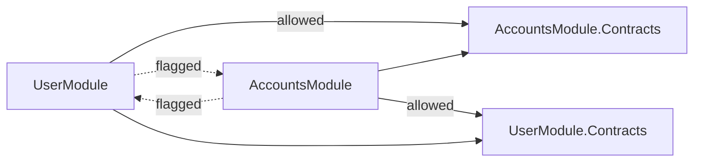

# Contracts

[← Docs index](README.md)

The `*.Contracts` projects

## Structure

- **`Requests/`** — input DTOs for endpoints (e.g. `CreateUserRequest`, `UpdateUserRequest`).
- **`Responses/`** — output DTOs returned to callers (e.g. `UserResponse`).
- **`Events/`** — integration events published on the message bus (e.g. `UserCreatedIntegrationEvent`, `AccountOpenedIntegrationEvent`).

## Why Contracts Are Separate

- **Isolation.** A module can consume another module's events/requests without touching its implementation.
- **Stability.** Contracts change deliberately; internal models can evolve freely behind them.
- **Enforceability.** The [analysers](analysers.md) allow references to `*.Contracts` but flag references to module implementations.



A module may depend on any `*.Contracts` project, but never on another module's implementation (dotted lines are build errors).

## Guidelines

- Keep contract types small, serializable and free of behaviour.
- Version integration events carefully — other modules depend on their shape.
- Never leak internal domain models through contracts.

## Example

Requests and responses are plain, serializable records; integration events derive from `Message`:

```csharp
public sealed record CreateUserRequest
{
    public required string FullName { get; init; }
    public required string Email { get; init; }
    public string? PhoneNumber { get; init; }
}

public sealed record UserResponse
{
    public required int Id { get; init; }
    public required string FullName { get; init; }
    public required string Email { get; init; }
    public string? PhoneNumber { get; init; }
}

public sealed record UserCreatedIntegrationEvent : Message
{
    public required int Id { get; init; }
    public required string FullName { get; init; }
    public required string Email { get; init; }
}
```

## Related Docs

- [Feature Modules](modules.md)
- [Messaging & Reliability](messaging.md)
