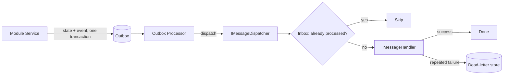

# Messaging & Reliability

[← Docs index](README.md)

Modules communicate through

## Building Blocks

- **Message dispatch** — `IMessageDispatcher` / `InProcessMessageDispatcher` route messages to registered handlers. Modules register handlers with `AddMessageHandler<TMessage, THandler>()` and declare published contracts with `AddMessageContract<T>()`.
- **Outbox** — integration events are written to an outbox in the **same transaction** as the state change. `OutboxProcessor` later reads and dispatches them, so events are never lost if the process crashes after commit.
- **Dead-letter** — messages that repeatedly fail are moved aside; the host exposes dead-letter management endpoints (`Api/Outbox/`).
- **Inbox** — `IInboxStore` records processed message ids so an event handled more than once is not applied twice.
- **Idempotency** — `IdempotencyFilter` / idempotency keys make inbound requests and message processing safe under retries.

## Typical Flow

1. A module service changes state and enqueues an integration event via the outbox in one transaction.
2. `OutboxProcessor` picks up unpublished events and dispatches them.
3. Subscribing modules handle the event; the **inbox** ensures it is processed once.
4. Persistent failures are routed to the dead-letter store for inspection/replay.



## Example

A module registers what it publishes and what it handles during `RegisterServices`:

```csharp
// Publish contracts this module raises
serviceCollection.AddMessageContract<UserUpdatedIntegrationEvent>();
serviceCollection.AddMessageContract<UserDeletedIntegrationEvent>();

// Subscribe to another module's event
serviceCollection.AddMessageHandler<AccountOpenedIntegrationEvent, AccountOpenedHandler>();
```

A handler implements `IMessageHandler<TMessage>`:

```csharp
internal sealed class AccountOpenedHandler(ILogger<AccountOpenedHandler> logger)
    : IMessageHandler<AccountOpenedIntegrationEvent>
{
    public Task HandleAsync(AccountOpenedIntegrationEvent message, CancellationToken cancellationToken = default)
    {
        ArgumentNullException.ThrowIfNull(message);
        UserMessagingLog.AccountOpenedForUser(logger, message.UserId, message.AccountNumber);
        return Task.CompletedTask;
    }
}
```

## Related Docs

- [Architecture](architecture.md)
- [Shared Kernel](shared-kernel.md)
- [Contracts](contracts.md)
